# Deep Convolutional GAN (DCGAN) on CelebA Human Face Dataset 🎨👤

[](https://www.python.org/)
[](https://pytorch.org/)
[](https://pytorch.org/vision/)
[](https://streamlit.io/)
[](http://mmlab.ie.cuhk.edu.hk/projects/CelebA.html)
[](#license)

An end-to-end implementation of **Deep Convolutional Generative Adversarial Networks (DCGAN)** trained on the **CelebA (CelebFaces Attributes)** dataset to synthesize realistic human face images from 100-dimensional random Gaussian latent noise vectors $z \sim \mathcal{N}(0, 1)$.

The project implements the foundational architecture proposed by Radford et al. (2015), featuring strided convolutions, batch normalization, leaky activations, adversarial training monitoring, and an interactive **Streamlit** dashboard with real-time face generation and smooth latent space interpolation (face morphing).

---

## 🌟 Key Features

- **DCGAN Network Architectures:**
  - **Generator ($G$):** Five-layer transposed convolutional network projecting a 100-dim latent vector up to a $3 \times 64 \times 64$ RGB image with `Tanh` activation.
  - **Discriminator ($D$):** Strided convolutional classifier with `LeakyReLU(0.2)` activations mapping images to a scalar probability $[0, 1]$ (`Sigmoid`).
- **CelebA Preprocessing Pipeline:** Automates center-cropping, bilinear downsampling to $64 \times 64$, and tensor normalization to $[-1, 1]$ matching the generator's hyperbolic tangent range.
- **Minimax Adversarial Training:** Implements the two-player non-saturating minimax objective using Adam optimizers ($\text{lr}=0.0002, \beta_1=0.5$).
- **Latent Space Interpolation:** Generates continuous geodesic walks between two distinct latent vectors $z_A$ and $z_B$, visualizing seamless transitions between facial identities, hair styles, and skin tones.
- **Interactive Streamlit Web Dashboard:**
  - 🎲 Real-time face synthesis with customizable seeds and temperature.
  - 🎛️ Continuous latent manifold slider (Face Morphing).
  - 📈 Training loss analytics ($G_{\text{loss}}$ vs $D_{\text{loss}}$).
  - 👥 Side-by-side ground truth CelebA explorer.
- **Research Notebook:** Includes `celeb_a_dcgan.ipynb` walking through dataset loading, training, and manifold evaluation.

---

## 🏗️ System Architecture

```mermaid
flowchart LR
    subgraph LatentSpace ["Latent Space"]
        Z["Random Noise Vector z ~ N(0, 1)<br>(100-dim)"]
    end

    subgraph GeneratorNet ["1. Generator (G)"]
        Z --> G1["ConvTranspose2d (nz -> 512, 4x4) + BatchNorm + ReLU"]
        G1 --> G2["ConvTranspose2d (512 -> 256, 8x8) + BatchNorm + ReLU"]
        G2 --> G3["ConvTranspose2d (256 -> 128, 16x16) + BatchNorm + ReLU"]
        G3 --> G4["ConvTranspose2d (128 -> 64, 32x32) + BatchNorm + ReLU"]
        G4 --> G5["ConvTranspose2d (64 -> 3, 64x64) + Tanh"]
    end

    subgraph SyntheticFaces ["Generated Faces"]
        G5 --> Fake["Synthetic Image G(z)<br>Shape: 3x64x64, Range: [-1, 1]"]
    end

    subgraph RealData ["2. CelebA Dataset"]
        Real["Real CelebA Faces<br>CenterCrop -> 64x64 -> Norm [-1, 1]"]
    end

    subgraph DiscriminatorNet ["3. Discriminator (D)"]
        Fake --> D1["Conv2d (3 -> 64, 32x32) + LeakyReLU(0.2)"]
        Real --> D1
        D1 --> D2["Conv2d (64 -> 128, 16x16) + BN + LeakyReLU"]
        D2 --> D3["Conv2d (128 -> 256, 8x8) + BN + LeakyReLU"]
        D3 --> D4["Conv2d (256 -> 512, 4x4) + BN + LeakyReLU"]
        D4 --> D5["Conv2d (512 -> 1, 1x1) + Sigmoid"]
        D5 --> Prob["Probability D(x) in [0, 1]<br>Real (1) vs Fake (0)"]
    end
```



---

## 📐 Mathematical Formulation

The Generator $G$ and Discriminator $D$ engage in a zero-sum minimax game:

$$\min_G \max_D V(D, G) = \mathbb{E}_{x \sim p_{\text{data}}(x)}[\log D(x)] + \mathbb{E}_{z \sim p_z(z)}[\log(1 - D(G(z)))]$$

In practice, to avoid vanishing gradients early in training, the Generator is trained using the **non-saturating objective**:

$$\max_G \mathbb{E}_{z \sim p_z(z)}[\log D(G(z))]$$

---

## 📁 Repository Structure

```text
CelebA_Face_DCGAN/
│
├── app.py                          # Streamlit interactive face generator & interpolation dashboard
├── models.py                       # Generator and Discriminator PyTorch neural networks
├── dataset.py                      # CelebA dataset loader, preprocessing, and normalization
├── train.py                        # Complete adversarial training loop with checkpointing
├── celeb_a_dcgan.ipynb             # Research & empirical evaluation Jupyter notebook
├── requirements.txt                # Production dependencies
├── .gitignore                      # Git exclusion rules
│
├── .streamlit/
│   └── config.toml                 # Streamlit UI theme configuration
│
├── checkpoints/                    # Saved model weights (generator.pth, discriminator.pth)
├── samples/                        # Generated visual progression grids across training epochs
└── data/
    └── celeba/
        └── img_align_celeba/       # Aligned and cropped CelebA face images
```

---

## ⚙️ Technology Stack

| Component | Technology | Description |
| :--- | :--- | :--- |
| **Deep Learning Framework** | [PyTorch](https://pytorch.org/) | Deep neural network design and adversarial backpropagation |
| **Vision Utilities** | [Torchvision](https://pytorch.org/vision/) | Image transforms, tensor normalization, and image grids |
| **User Interface** | [Streamlit](https://streamlit.io/) | Interactive real-time face generator and latent space explorer |
| **Numerical Computing** | `numpy`, `matplotlib` | Latent space vector operations and loss visualization |
| **Dataset** | [CelebA](http://mmlab.ie.cuhk.edu.hk/projects/CelebA.html) | High-diversity aligned celebrity face dataset |

---

## 🚀 Getting Started

### Prerequisites
- **Python 3.11** recommended
- NVIDIA GPU with CUDA (recommended for fast training) or CPU inference

---

### Installation & Setup

1. **Navigate to the project folder:**
   ```bash
   cd CelebA_Face_DCGAN
   ```

2. **Create and activate a virtual environment:**
   * **Windows (PowerShell):**
     ```powershell
     py -3.11 -m venv .venv
     .\.venv\Scripts\Activate.ps1
     ```
   * **Linux / macOS:**
     ```bash
     python3.11 -m venv .venv
     source .venv/bin/activate
     ```

3. **Install dependencies:**
   ```bash
   python -m pip install --upgrade pip
   pip install -r requirements.txt
   ```

---

### Training the DCGAN

To execute the adversarial training loop from the command line:
```bash
python train.py
```
Checkpoints will be saved automatically to `checkpoints/` and epoch progression grids to `samples/`.

---

### Running the Interactive Web Application

Launch the Streamlit web dashboard:
```bash
streamlit run app.py
```
Open `http://localhost:8501` to:
1. Synthesize new face grids from random seeds.
2. Interpolate between two latent face vectors (Latent Space Manifold Walk).
3. Inspect training loss curves and real CelebA dataset samples.

---

## 📖 Theoretical References

- Radford, A., Metz, L., & Chintala, S. (2015). *Unsupervised Representation Learning with Deep Convolutional Generative Adversarial Networks*. arXiv preprint [arXiv:1511.06434](https://arxiv.org/abs/1511.06434).
- Liu, Z., Luo, P., Wang, X., & Tang, X. (2015). *Deep Learning Face Attributes in the Wild*. Proceedings of International Conference on Computer Vision (ICCV).

---

## 🛡️ License

Developed for educational and academic research purposes.
